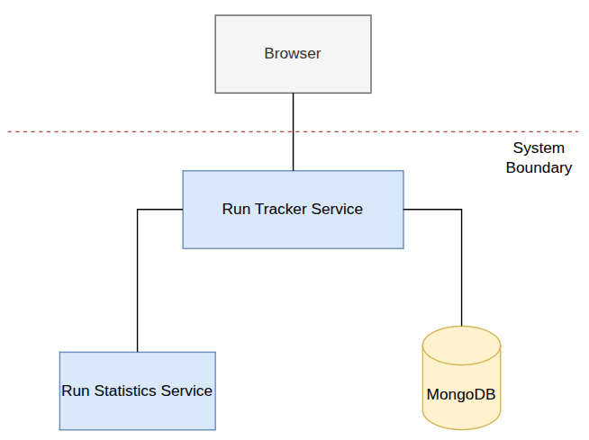

# Run Tracker

A small microservice-based application for storing running activities and calculating statistics for them. The project was developed for the **Applied Cloud Computing and Big Data** course and is deployed locally using Kubernetes and Minikube.

## Contents

- [Run Tracker](#run-tracker)
  - [Contents](#contents)
  - [Description](#description)
  - [Running the Application](#running-the-application)
    - [Requirements](#requirements)
    - [1. Start Minikube](#1-start-minikube)
    - [2. Deploy the application](#2-deploy-the-application)
    - [3. Check that the Pods are running](#3-check-that-the-pods-are-running)
    - [4. Open the application](#4-open-the-application)
    - [5. Remove the deployment](#5-remove-the-deployment)
  - [Architecture](#architecture)
  - [Microservices and REST APIs](#microservices-and-rest-apis)
    - [Run Tracker Service](#run-tracker-service)
    - [Run Statistics Service](#run-statistics-service)
    - [MongoDB](#mongodb)
  - [Scaling](#scaling)
  - [Presentation](#presentation)

## Description

Run Tracker allows a user to add runs through a simple browser interface. Each run contains:

- distance in kilometers
- duration in minutes
- start date and time

The application displays the stored runs together with statistics such as:

- number of runs
- total distance
- total duration
- average pace in minutes per kilometer

The application is intentionally small. Its main purpose is to demonstrate a containerized microservice architecture, REST communication, Kubernetes deployment, horizontal scaling, and persistent database storage.

## Running the Application

### Requirements

The following tools are required:

- Docker
- Minikube
- kubectl

### 1. Start Minikube

```bash
minikube start
```

### 2. Deploy the application

From the repository root:

```bash
kubectl apply -f kubernetes/application.yaml
```

### 3. Check that the Pods are running

```bash
kubectl get pods
```


### 4. Open the application

```bash
minikube service run-service
```

This opens the Run Tracker web interface in the browser.

### 5. Remove the deployment

```bash
kubectl delete -f kubernetes/application.yaml
```

The Kubernetes deployment configuration is located at:

```text
kubernetes/application.yaml
```

## Architecture



The application consists of two custom, stateless application microservices and a MongoDB database.

The browser communicates only with the **Run Tracker Service**. Run data is stored in MongoDB. When statistics are requested, the Run Tracker Service retrieves the stored runs and sends them through REST to the **Run Statistics Service**, which performs the calculations and returns the result.

Both application services are stateless and can be scaled independently.

## Microservices and REST APIs

### Run Tracker Service

The Run Tracker Service is implemented using Node.js and Express and also serves the web interface.

Its main responsibilities are:

- receiving run data from the user
- storing and retrieving runs from MongoDB
- requesting statistics from the Run Statistics Service

REST endpoints:

| Method | Endpoint | Description |
|---|---|---|
| GET | `/runs` | Returns the stored runs |
| POST | `/runs` | Creates and stores a new run |
| GET | `/statistics` | Retrieves the runs and requests calculated statistics |

Persistent data is not stored inside the Run Tracker container. Instead, it is stored in MongoDB, allowing multiple Run Tracker replicas to access the same data.

### Run Statistics Service

The Run Statistics Service is also implemented using Node.js and Express.

REST endpoint:

| Method | Endpoint | Description |
|---|---|---|
| POST | `/statistics` | Receives run data and returns calculated statistics |

The service calculates:

- number of runs
- total distance
- total duration
- average pace

The service does not access MongoDB and does not store persistent state.

### MongoDB

MongoDB runs as a separate database service and is accessed only by the Run Tracker Service.

MongoDB stores its data under `/data/db`. In Kubernetes, this directory is mounted to persistent storage so that the stored runs are preserved when the MongoDB Pod is recreated.

## Scaling

The Run Tracker Service and Run Statistics Service are deployed using Kubernetes **Deployments**, they are stateless and can run with multiple replicas.

They can be scaled independently, via `kubectl scale` as below:

```bash
kubectl scale deployment/run-service --replicas=3
```

```bash
kubectl scale deployment/statistics-service --replicas=2
```

## Presentation

[Run Tracker APP short presentation](docs/Run_Tracker_App_Presentation.pdf)